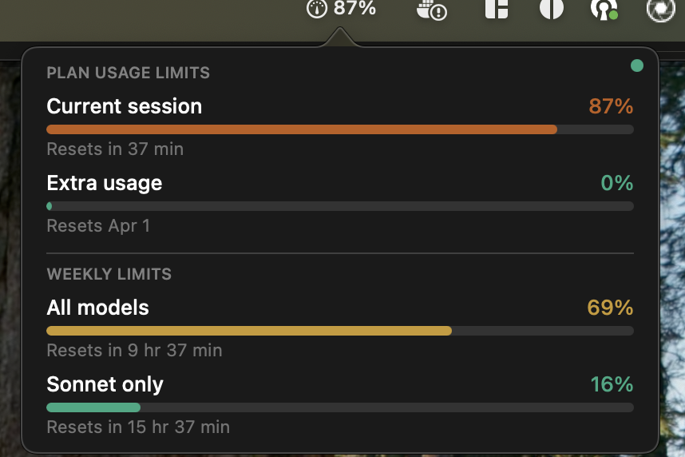

# ClaudeMeter

A lightweight macOS menu bar app that shows your Claude.ai usage at a glance — session limits, weekly limits, and progress bars in a compact popover.

Authenticates automatically by importing your session from the Claude Desktop app.

## Features

- **One-click usage** — click the menu bar icon to see current session and weekly usage
- **Menu bar badge** — optionally show your session usage percentage right in the menu bar
- **Background badge polling** — badge auto-updates on a configurable interval (30s / 1m / 2m / 5m / 10m), even when the popover is closed
- **Auto-refresh** — configurable popover polling interval (6s / 20s / 30s / 60s) keeps data fresh while viewing
- **Status indicator** — green dot (fresh), yellow dot (believed fresh, verifying), grey dot (stale), with a spinning loader during fetches
- **Auto-auth** — imports cookies from Claude Desktop on launch, no manual login needed
- **Fresh on open**: re-opening the popover fetches fresh numbers for every account without reloading any page
- **Auto-update** — check for updates from the menu bar with code signature verification
- **Fallback login** — right-click → "Sign In..." for email/magic-link if Claude Desktop isn't available
- **Multiple accounts** (v2.8): meter several claude.ai accounts side by side, for example personal and work. Each extra account signs in through ClaudeMeter's own login window into its own isolated session, so no account signs another out. The menu bar badge can show two accounts at once (`P 47% | W 12%`) and the popover stacks one section per account.
- **Activity dot** (v2.8): a small dot under each percentage in the menu bar shows how fast that session is being used, in the same colours as the popover's burn-rate chip (green under 1%/h, gold under 5%/h, orange under 15%/h, red above). No dot when usage is idle. Right-click → Show Activity Dot turns it off.

## Peek In



## Requirements

- macOS 13+ (Ventura or later)
- Claude Desktop installed and signed in (for the first account)
- macOS 14+ (Sonoma or later) to add more accounts. On macOS 13 ClaudeMeter stays single-account and the Add Account item is hidden.

## Install

1. Download **ClaudeMeter.zip** from the [latest release](https://github.com/Drozes/ClaudeMeter/releases/latest)
2. Unzip the archive
3. **Right-click** ClaudeMeter.app → **Open** (required on first launch since the app isn't notarized)
4. On first launch, the app will offer to move itself to your Applications folder

> **Note:** Double-clicking will show "Apple could not verify" — this is normal for community-distributed apps. Right-click → Open bypasses this. You only need to do this once.

macOS will show a Keychain access dialog on first run — click **Always Allow**.

To update later, right-click the menu bar icon → **Check for Updates…**

### Build from Source

If you prefer to build it yourself:

```bash
swiftc ClaudeMeter.swift \
  -framework Cocoa \
  -framework WebKit \
  -framework Security \
  -lsqlite3 \
  -parse-as-library \
  -o ClaudeMeter

./ClaudeMeter
```

Or open `ClaudeMeter.xcodeproj` in Xcode and hit **⌘R** for a proper `.app` bundle.

## Usage

| Action | How |
|---|---|
| View usage | Left-click the menu bar icon |
| Refresh data | Close and re-open the popover, or right-click → Reload |
| Show usage badge | Right-click → Show Usage in Menu Bar |
| Change badge refresh interval | Right-click → Badge Refresh Interval → pick 30s / 1m / 2m / 5m / 10m |
| Change refresh interval | Right-click → Refresh Interval → pick 6s / 20s / 30s / 60s |
| Re-import cookies | Right-click → Import from Claude Desktop |
| Manual login | Right-click → Sign In... |
| Add an account (macOS 14+) | Right-click → Add Account… (with two or more accounts: Accounts → Add Account…) |
| Re-sign-in an account | Right-click → Accounts → *account* → Sign In Again… (or the "Sign In Again to *name*…" item / popover button when it is signed out) |
| Rename an account | Right-click → Accounts → *account* → Rename… |
| Choose what the badge shows | Right-click → Accounts → *account* → Badge Position → Left / Right / Hidden |
| Change an account's badge label | Right-click → Accounts → *account* → Badge Label… (1 to 3 characters) |
| Remove an account | Right-click → Accounts → *account* → Remove… (not available for the first account) |
| Change an account's colour | Right-click → Accounts → *account* → Colour → pick one of 8 colours |
| Show or hide the activity dot | Right-click → Show Activity Dot |
| Check for updates | Right-click → Check for Updates… |
| Quit | Right-click → Quit |

## Multiple Accounts

The first account is the one Claude Desktop is signed in to; ClaudeMeter imports its session automatically, exactly as before. With only that account, nothing changes: the badge reads `47%` and the popover looks as it always did.

To add another account (macOS 14+), right-click → **Add Account…**, give it a name (for example "Work"), and sign in in the window that opens. SSO sign-ins (Okta, Microsoft Entra ID, Google and others) work through the same window. The window closes only once claude.ai confirms the sign-in. If the account belongs to several organizations, ClaudeMeter asks which one to meter and sticks to that choice.

**Badge forms**

| Situation | Badge |
|---|---|
| One account | `47%` |
| Two or more accounts, one badge position used | `W 47%` |
| Both positions used (left first) | `P 47% \| W 12%` |
| An account that is signed out | `W --` |

With two or more accounts, "Import from Claude Desktop" and "Sign In…" move from the top of the menu into Accounts → (first account), next to Sign In Again… (⌘I and ⌘L work there while the menu is open).

Each account has a colour (Blue, Purple, Indigo, Teal, Cyan, Magenta, Graphite or Brown; the first account starts Blue, each new account gets the next unused colour). It tints the account's badge label, marks its section header in the popover, and shows as a swatch in the Accounts menu. With one account the badge has no label, so nothing changes.

Team and Enterprise seats show their plan as "Team" or "Enterprise" (or "Work plan" when claude.ai does not say which).

**Plans without a session limit**: some plans (for example Max) currently report only a weekly window. For such an account the badge shows its weekly percentage instead of a session percentage, the tooltip (and VoiceOver) says "weekly … no session limit on this plan", and the activity dot follows the weekly burn rate. If a session window comes back, the badge returns to it straight away.

Each account has a badge position (Left, Right or Hidden; a position holds one account, so choosing an occupied one moves the previous account to Hidden) and a 1 to 3 character label, by default the first letter of its name. A new account takes Right if it is free, otherwise Hidden. If no account has a position, the badge shows the first account. Hovering the badge lists every account.

**Popover**: with two or more accounts, the popover shows one section per account under a header with its name, organization and plan. An account whose session has expired shows a compact "Signed out" row with a **Sign In Again…** button instead of old numbers.

**Signed out**: if an added account's session expires, ClaudeMeter never opens a window on its own. It checks with claude.ai before marking the account signed out, re-checks quietly every 15 minutes, and offers "Sign In Again to *name*…" in the menu. The first account keeps the old behavior and opens its sign-in window when needed.

**Notifications** are tracked per account; once you have two or more accounts, titles start with the account name, and snoozing one account does not snooze the others.

**Removing** an account deletes its saved settings, usage history and its isolated sign-in session from ClaudeMeter. It does not change your claude.ai account. The first account cannot be removed.

## How It Works

The app is a single Swift file (`ClaudeMeter.swift`) with no dependencies beyond system frameworks.

1. **Cookie import**: reads Claude Desktop's Chromium cookie database (`~/Library/Application Support/Claude/Cookies`), decrypts the cookies via the macOS Keychain, and stores them in the first account's WebKit store.
2. **Usage data**: each account fetches its numbers from claude.ai's usage API with its own cookies, read from its own WebKit store. Cookies that claude.ai sends back are written into that same store, so the session stays fresh without loading the page. One connection per account is reused between refreshes.
3. **Usage page, only when needed**: the hidden `claude.ai/settings/usage` page is loaded only to sign in, when the usage API fails (the page's DOM is then scraped as a fallback), and at most once every 6 hours per account as a safety net. Otherwise it is unloaded, which frees the memory of its web content process.
4. **Popover**: opening the popover fetches fresh numbers for every account; while it stays open, a timer refreshes at the configured interval.
5. **Badge**: the badge refreshes on its own timer with the popover closed. The percentage comes from the usage API; the XPath scrape of the page runs only for an account on the page fallback.
6. **Power**: refreshes pause while the Mac or its displays sleep, the screen is locked or another user is switched in, and each account fetches once on wake (opening the popover also ends a display, lock or session pause). In Low Power Mode, or when the Mac is running hot, the badge interval is doubled. The interval options in the menu do not change.

## Privacy

- Sign-in cookies live only in WebKit's own website data stores: the default store for the first account and one isolated store per added account. Cookies that claude.ai returns to an account's usage requests are written back into that account's own store, never into another account's. ClaudeMeter never writes cookies or tokens to its preferences, its files or its logs; logs carry cookie counts, never values.
- The only Keychain item ClaudeMeter reads is Claude Desktop's "Claude Safe Storage" key, to import the first account's session. To read Claude Desktop's (encrypted) cookie database, the import briefly copies it to a temporary file and deletes that copy as soon as it is read. ClaudeMeter never reads, writes or deletes any Claude Code credentials (`Claude Code-credentials*`) and never touches Claude Code's configuration.
- Saved per-account settings are non-secret and live in ClaudeMeter's preferences: the account's display name, email (if known), organization ID and name, plan tier, colour, and badge label and position. No cookies or tokens are stored there. Usage history is kept in `~/Library/Application Support/ClaudeMeter/history-<account>.json` (24 hours). The v2.7.1 `history.json` is left in place after the upgrade (copied, not moved) as a rollback path.

## Troubleshooting

**"Apple could not verify"** — Right-click the app → Open. Alternatively, go to System Settings → Privacy & Security, scroll down, and click "Open Anyway".

**Keychain dialog keeps appearing** — Click "Always Allow" instead of "Allow".

**"Could not import session"** — Make sure Claude Desktop is installed and signed in.

**Blank or wrong content** — Anthropic may have changed their page markup. Adjust the `usageCSS` selectors in `ClaudeMeter.swift`.

**Fresh start** (signs every account out, including added ones):
```bash
rm -rf ~/Library/WebKit/com.local.ClaudeMeter/
rm -rf ~/Library/Caches/com.local.ClaudeMeter/
rm -f  ~/Library/HTTPStorages/com.local.ClaudeMeter.binarycookies
```

## License

MIT
